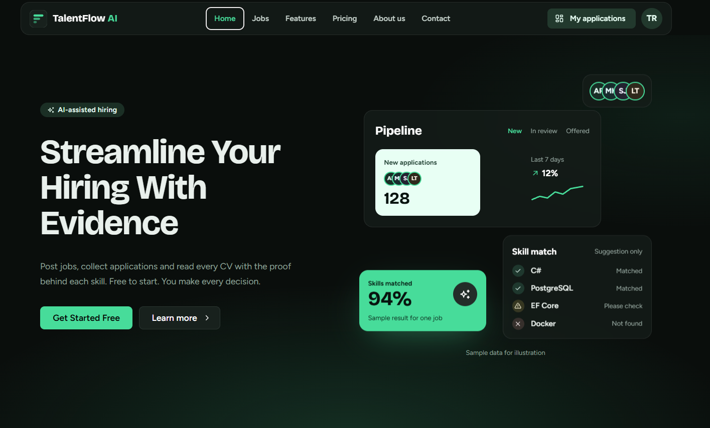
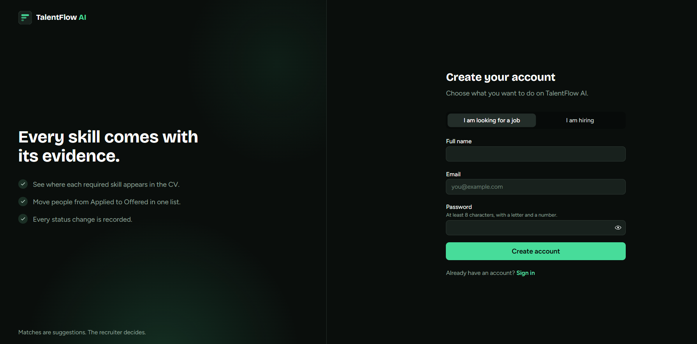
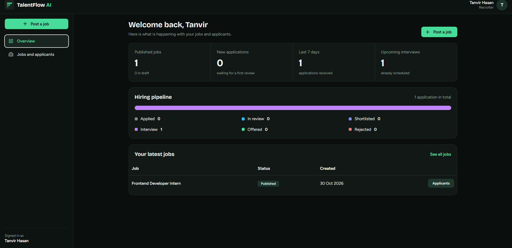

# TalentFlow AI

An AI-assisted **Recruitment & Applicant Tracking System** built with **ASP.NET Core Web API (.NET 10)**, **Entity Framework Core** and **PostgreSQL**.

Companies publish jobs, candidates apply with a PDF CV, recruiters move applications through a pipeline, and a skill matcher compares the CV with the job requirements and shows **evidence**. The matcher only gives suggestions - **the recruiter always makes the final decision**.

## Problem

CVs, jobs, interviews and statuses are often in different places. It is slow to find the needed skills in many CVs, and there is no history of who changed a status. TalentFlow AI keeps everything in one API.
## Screenshots

### Home Page


### Login Page


### Dashboard


## Features

| Area | What it does |
| --- | --- |
| Authentication | Register / login with JWT. Roles: **Candidate** and **Recruiter**. Passwords are hashed with BCrypt. |
| Jobs | Create, list, details, edit, close, delete draft. Search by title, skill, experience level. Pagination. |
| Applications | Apply once per job (duplicate blocked by code **and** a database unique index). Status workflow with audit log. |
| Resumes | PDF only, 5 MB max, checks extension + content type + real `%PDF-` signature. Saved in a private folder with a random name. |
| Skill matching | Rule-based matcher: matched skills + evidence text, missing skills, "needs review". No external service needed. |
| Interviews | Recruiters schedule interviews and write private feedback. |
| Dashboard | Job counts, new applications, upcoming interviews, pipeline summary. |
| Security | Role + ownership + company checks on every request, global error format, rate limit on login/register. |
| Tests | 56 xUnit tests for business rules, security rules and failure handling. |

## Tech stack

C# / ASP.NET Core Web API (.NET 10) - PostgreSQL - EF Core + Npgsql - JWT Bearer - BCrypt.Net - PdfPig (PDF text) - Swagger - xUnit.

## Project structure

```
TalentFlow.AI/
├── TalentFlow.AI.sln
├── README.md  .gitignore  .editorconfig  .env.example
├── .config/dotnet-tools.json        (dotnet-ef tool)
├── docs/                            (architecture, database, API docs)
├── src/TalentFlow.Api/
│   ├── Program.cs                   (setup: DI, JWT, Swagger, middleware)
│   ├── Controllers/                 (HTTP endpoints only, no business logic)
│   ├── Services/ + Interfaces/      (business rules)
│   ├── Entities/                    (database classes + enums)
│   ├── DTOs/                        (request / response classes)
│   ├── Data/                        (DbContext, Configurations, Migrations, demo seeder)
│   ├── Authorization/               (policy names, ApplicationAccess ownership check)
│   ├── Middleware/                  (global exception handling)
│   ├── Validators/                  (CV file validation)
│   ├── Mapping/                     (Entity -> DTO)
│   └── Common/                      (exceptions, paging, settings)
└── tests/TalentFlow.Tests/          (unit tests, in-memory database)
```

## What you need to install

1. **.NET 10 SDK** (https://dotnet.microsoft.com/download) - check with `dotnet --version`.
   *Only have .NET 8 or 9? Change `<TargetFramework>` in both `.csproj` files to `net8.0`/`net9.0` and use `8.0.x`/`9.0.x` versions of the Microsoft/Npgsql EF packages.*
2. **PostgreSQL** + pgAdmin (remember your `postgres` password).
3. **Visual Studio 2022/2026** with the *ASP.NET and web development* workload (or VS Code).
4. Git (optional).

## Setup (step by step)

Open a terminal in the `TalentFlow.AI` folder.

**1. Create the database** (pgAdmin -> right-click Databases -> Create -> Database -> name `talentflow_db`).

**2. Set your secrets** (never commit them). Replace the values:

```bash
dotnet user-secrets set "ConnectionStrings:DefaultConnection" "Host=localhost;Port=5432;Database=talentflow_db;Username=postgres;Password=YOUR_PASSWORD" --project src/TalentFlow.Api
dotnet user-secrets set "Jwt:Key" "put-a-long-random-text-here-at-least-32-characters" --project src/TalentFlow.Api
```

**3. Create the first migration** (one time only):

```bash
dotnet tool restore
dotnet ef migrations add InitialCreate --project src/TalentFlow.Api --output-dir Data/Migrations
```

**4. Run the API** (in Development it applies the migration and adds fake demo data automatically):

```bash
dotnet run --project src/TalentFlow.Api --launch-profile https
```

Swagger opens at `https://localhost:7085/swagger`. Health check: `/health`.

> In Visual Studio: set `TalentFlow.Api` as the startup project and press F5. Do step 2 with *right-click project -> Manage User Secrets* if you prefer.

## Demo accounts (fake data, Development only)

| Role | Email | Password |
| --- | --- | --- |
| Recruiter | recruiter@demo.com | Demo@12345 |
| Candidate | candidate@demo.com | Demo@12345 |

## Try it in Swagger (5 minutes)

1. `POST /api/auth/login` with the candidate account -> copy the `token`.
2. Click **Authorize** (top right), paste the token, click Authorize.
3. `GET /api/jobs` -> note a job `id`.
4. `POST /api/resumes` -> upload any text-based PDF CV.
5. `POST /api/jobs/{jobId}/apply` with body `{}` -> status `Applied`. Try again -> **409 Conflict** (duplicate blocked).
6. Log in as the recruiter, authorize with the new token.
7. `GET /api/jobs/{jobId}/applications` -> note the `applicationId`.
8. `POST /api/applications/{id}/ai-analysis` -> see matched skills, evidence, missing skills.
9. `PATCH /api/applications/{id}/status` with `{ "status": "InReview" }` -> then try `"Offered"` -> **422** (not allowed).
10. `GET /api/dashboard/summary` -> pipeline numbers.

## Run the tests

```bash
dotnet test
```

The tests use an in-memory database, so no PostgreSQL is needed for them.

## Main endpoints

See [docs/api-specification.md](docs/api-specification.md) for the full list with examples.

## Design decisions (good for interviews)

- **One API project + one test project** - simple, no over-engineering (as the guide recommends).
- **Controllers are thin**, services hold rules, DTOs protect entities from being exposed.
- **Services throw small exception classes** (`NotFoundException`, `ConflictException` ...); one middleware turns them into a consistent JSON error.
- **Duplicate applications** are stopped twice: a check in `ApplicationService` and a unique index on `(JobId, CandidateProfileId)` for race conditions.
- **Ownership / company scope** is in one place (`ApplicationAccess`). Not-allowed access returns **404**, so IDs cannot be guessed.
- **A recruiter can only create a new company**, never join an existing one by name (prevents taking over another company).
- **AI is optional**: if analysis fails, status = `Failed` and the application is untouched (there is a test for this). The CV text is treated as data, never as instructions.
- **No sensitive traits** (gender, age, religion, photo ...) are used. The matcher uses skills only and does not rank or reject anyone.
- **Dates are UTC.** CV files are never in a public folder; download checks permission first.

## Security checklist

- Passwords hashed (BCrypt); JWT signed key from user-secrets / environment, never in Git.
- `.gitignore` excludes secrets, `PrivateStorage/` (CVs) and build output.
- CV: size, extension, content type and signature checks; random file name; private folder.
- Logs never contain passwords, tokens or CV text.
- Before production: use HTTPS, a managed PostgreSQL, private object storage, backups, and write a privacy / data-retention policy.

## Not included in this MVP (honest list)

- React / Blazor front end (Swagger is the UI).
- A real LLM provider (the matcher is rule-based; `ISkillMatchingService` is the place to plug one in).
- OCR for scanned PDFs (these are marked "needs review").
- Docker, CI/CD, e-mail notifications, Admin screens.
- API integration tests against a real PostgreSQL database.

## Troubleshooting

| Problem | Fix |
| --- | --- |
| `Jwt:Key is missing or too short` | Do step 2 (key must be 32+ characters). |
| `No database migration was found` | Do step 3. |
| `password authentication failed` | Check the password in your connection string. |
| `relation "Users" does not exist` | Migration was not applied - run the app in Development after step 3. |
| NuGet package version not found | Use the newest stable version of that package. |
| Port already in use | Change `applicationUrl` in `Properties/launchSettings.json`. |
