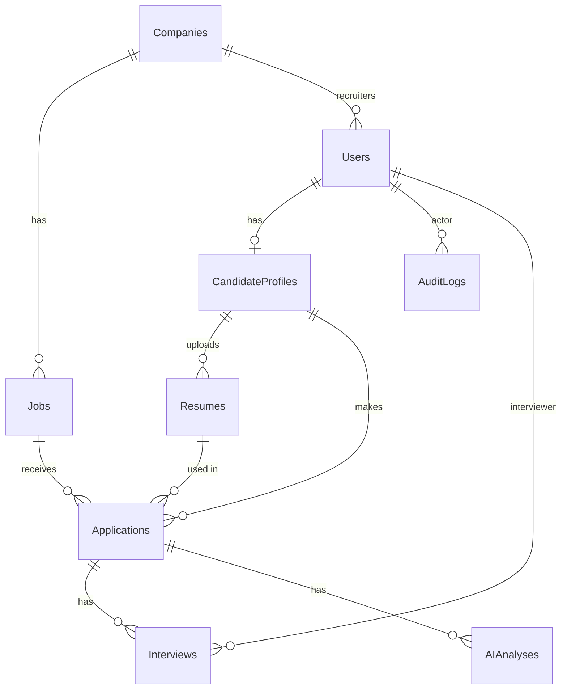

# Database design

| Table | Important columns | Rules |
| --- | --- | --- |
| Companies | Id, Name, Website, CreatedAt | Name unique |
| Users | Id, CompanyId (nullable), FullName, Email, PasswordHash, Role | Email unique; Role saved as text |
| CandidateProfiles | Id, UserId, Summary, Education, ExperienceYears, Skills | One per candidate user |
| Jobs | Id, CompanyId, Title, Description, RequiredSkills, ExperienceLevel, Status, Deadline | Index (CompanyId, Status) and (Status) |
| Resumes | Id, CandidateProfileId, StorageKey, OriginalFileName, ContentType, SizeBytes, ExtractedText | File bytes are NOT in the database |
| Applications | Id, JobId, CandidateProfileId, ResumeId, Status, AppliedAt, RecruiterNotes | **Unique (JobId, CandidateProfileId)** |
| Interviews | Id, ApplicationId, InterviewerUserId, StartAtUtc, EndAtUtc, MeetingLink, Feedback | CHECK StartAtUtc < EndAtUtc |
| AIAnalyses | Id, ApplicationId, Status, ExtractedSkillsJson, EvidenceJson, MissingSkillsJson, NeedsReviewJson, Provider | Failure does not touch the application |
| AuditLogs | Id, ActorUserId, EntityType, EntityId, Action, CreatedAtUtc | Index (EntityType, EntityId) |

Enums (statuses, roles) are stored as text and limited by the C# enum. All dates are UTC. The schema is created only with EF Core migrations.
